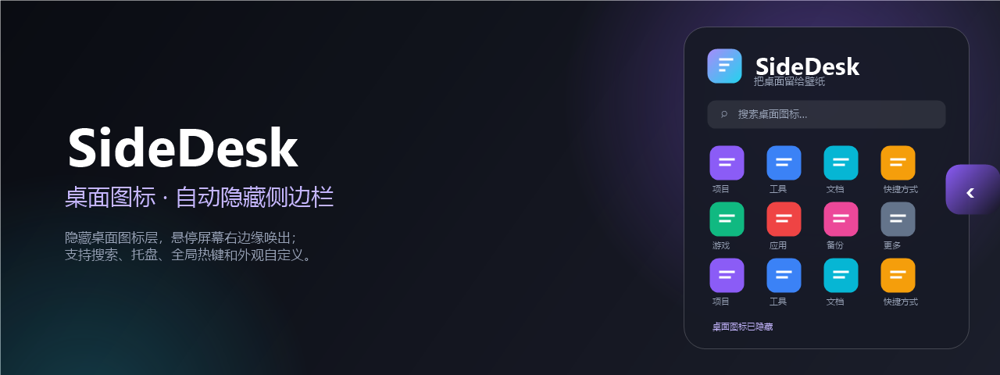

# SideDesk · 桌面图标侧边栏

把桌面图标收进屏幕右侧的自动隐藏侧边栏：壁纸保持干净，常用图标仍然触手可及。




## 下载

- **最新版**：<https://github.com/AuZn111/SideDesk/releases/latest>
- 也可以从本仓库的 `Releases` 页面下载便携版 zip。

## 开源协议

本项目使用 [MIT License](LICENSE) 开源。

## 功能

- **桌面图标一键收起**：启动后隐藏 Explorer 的桌面图标层，退出时自动恢复原始显示状态。
- **箭头自动隐藏**：侧边栏收起后不显示常驻细条；把鼠标移到屏幕右边缘时才出现箭头，离开后再次隐藏。
- **全屏应用不打扰**：检测到全屏游戏、视频、演示或最大化无边框窗口时自动隐藏侧边栏和箭头；Windows 桌面和任务栏不会被误判为全屏。进程以 `BelowNormal` 优先级运行。
- **右侧玻璃侧边栏**：停靠主屏右侧，鼠标移出后自动收起；展开/收起使用 520ms/420ms 的柔和滑动、淡入和内容位移动画。
- **图标直接启动**：双击打开文件、文件夹、快捷方式；右键可打开所在位置、复制路径。
- **搜索与键盘操作**：实时过滤桌面图标，`Ctrl+F` 聚焦搜索，`F5` 刷新。
- **固定展开**：图钉按钮让侧边栏保持打开，不自动收起。
- **外观个性化**：可调侧边栏主题色、不透明度和箭头不透明度，支持自定义十六进制颜色和实时预览。
- **托盘常驻**：托盘菜单可显示/收起侧栏、保持展开、切换桌面图标、开机启动和退出。
- **全局热键**：`Ctrl+Alt+D` 随时唤出或收起。
- **自动跟随桌面**：文件监视器会在桌面新增、删除、重命名项目后自动刷新。
- **轻量设置**：设置与日志保存在 `%APPDATA%\SideDesk`，不写入注册表以外的系统位置。

## 快速开始

1. 解压发布包，双击 `SideDesk.exe`。
2. 首次启动时侧边栏会展开，桌面图标会被暂时收起。
3. 等侧边栏自动收起后，把鼠标移到**屏幕右边缘**，箭头出现后移到箭头上即可滑出侧边栏。
4. 双击图标即可打开。点击顶部的图钉可以固定侧边栏。
5. 点击右上角 `⋯ → 外观设置…` 可调整侧边栏颜色、面板不透明度和箭头不透明度。
6. 打开全屏游戏或视频时，侧边栏会自动隐藏；全屏退出后，移动到屏幕右边缘即可再次唤出。

> 程序未签名，Windows SmartScreen 可能提示“未知发布者”。点击“更多信息 → 仍要运行”即可。

## 操作方式

| 操作 | 效果 |
| --- | --- |
| 鼠标移到屏幕右边缘 | 显示箭头 |
| 鼠标移到箭头上 / 点击箭头 | 滑出侧边栏 |
| 点击右上角 `›` | 收起侧边栏 |
| 双击图标 | 打开 |
| 右键图标 | 打开、打开所在位置、复制路径 |
| `Ctrl+Alt+D` | 唤出 / 收起侧边栏 |
| `Ctrl+F` | 聚焦搜索框 |
| `F5` | 刷新桌面图标 |
| `Esc` | 清除搜索 / 收起侧边栏 |
| 托盘左键 | 唤出并保持展开 |
| 托盘右键 | 更多操作，包括退出 |
| `Ctrl+Alt+D` 再次按下 | 收起手动唤出的侧边栏 |

## 外观设置

打开 `⋯ → 外观设置…`：

- **主题颜色**：8 个预设色 + 自定义 `#RRGGBB`，实时预览。
- **侧边栏不透明度**：35%–100%。
- **箭头不透明度**：15%–100%，默认 50%；箭头平时自动隐藏，移近屏幕右边缘时出现。

设置文件：`%APPDATA%\SideDesk\settings.json`  
日志文件：`%APPDATA%\SideDesk\SideDesk.log`

## 桌面图标怎么恢复

正常情况下，**退出 SideDesk 时会自动恢复**桌面图标到启动前的显示状态。

如果程序被任务管理器强制结束，图标可能仍处于隐藏状态，可以：

- 双击 `restore-desktop-icons.cmd`；或
- 运行 `SideDesk.exe --restore-icons`；或
- 重新启动 SideDesk，程序会自动恢复；也可通过底部“显示图标”按钮恢复。

“隐藏桌面图标”只是隐藏 Explorer 的图标层，不会删除、移动或修改任何桌面文件。

## 设置

托盘菜单或侧边栏右上角 `⋯` 菜单中可调整：

- 外观设置（侧边栏颜色/不透明度、箭头不透明度）
- 保持展开（固定侧栏）
- 开机自动启动（写入当前用户的 `HKCU\Software\Microsoft\Windows\CurrentVersion\Run`）
- 启动时隐藏桌面图标
- 恢复桌面图标
- 打开桌面文件夹
- 退出 SideDesk

## 命令行参数

| 参数 | 说明 |
| --- | --- |
| `--restore-icons` | 强制恢复桌面图标后退出 |
| `--diagnose [输出文件]` | 输出桌面图标层、桌面目录和屏幕信息后退出 |
| `--smoke-test [秒数]` | 自动退出测试模式；默认 12 秒，范围 3–120 秒 |

## 从源码构建

要求：Windows 10/11 x64、[.NET 9 SDK](https://dotnet.microsoft.com/download/dotnet/9.0)。

```powershell
dotnet build SideDesk.sln -c Release
dotnet run --project src\SideDesk\SideDesk.csproj
```

生成自包含单文件发布包：

```powershell
powershell -ExecutionPolicy Bypass -File .\build.ps1
```

输出位于 `dist\SideDesk.exe`，目标机器无需安装 .NET 运行时。

## 项目结构

```text
SideDesk.sln
build.ps1
src/SideDesk/
  App.xaml / App.xaml.cs         单实例、启动与恢复兜底
  MainWindow.xaml / .cs          侧边栏界面、动画、托盘、热键
  AppearanceWindow.xaml / .cs    外观设置窗口
  Interop/NativeMethods.cs       Win32 调用
  Models/DesktopItem.cs          桌面项目模型
  Services/
    DesktopIcons.cs              隐藏/恢复 Explorer 桌面图标层
    DesktopCatalog.cs            桌面枚举与文件监视
    ShellIcons.cs                通过系统图像列表读取高清图标
    TrayIconController.cs        托盘图标与菜单
    GlobalHotKey.cs              全局热键
    StartupManager.cs            开机启动
    SettingsStore.cs             设置持久化
    AppearanceTheme.cs           侧边栏主题色与透明度
    ColorUtil.cs                 颜色解析与混合
tools/
  restore-desktop-icons.ps1      独立图标恢复脚本
  restore-desktop-icons.cmd
```

## 兼容性与限制

- 针对 **Windows 10 / 11 x64** 开发，使用 WPF + Win32 Shell 接口。
- 侧边栏默认停靠**主显示器右侧**；多屏时其他屏幕不受影响。
- 图标按“文件夹 → 快捷方式 → 文件”的顺序排列，同类按名称自然排序；不保留桌面上的原始网格位置。
- 侧边栏默认置顶，以便覆盖普通窗口；检测到同屏全屏应用时会自动隐藏，避免遮挡游戏或视频。
- 不修改桌面文件，不需要管理员权限。

## 技术说明

桌面图标由 Explorer 的 `SHELLDLL_DefView → SysListView32` 承载。SideDesk 只对该窗口调用 `ShowWindow(SW_HIDE/SW_SHOW)`，并记录启动前的可见状态用于退出恢复。侧边栏收起后通过 `SetWindowRgn` 把窗口可点击区域收缩到 1×1 热点，并轮询光标位置：接近屏幕右边缘时显示箭头，离开后隐藏；箭头显示时窗口区域才扩大到箭头范围，避免挡住下层窗口点击。
